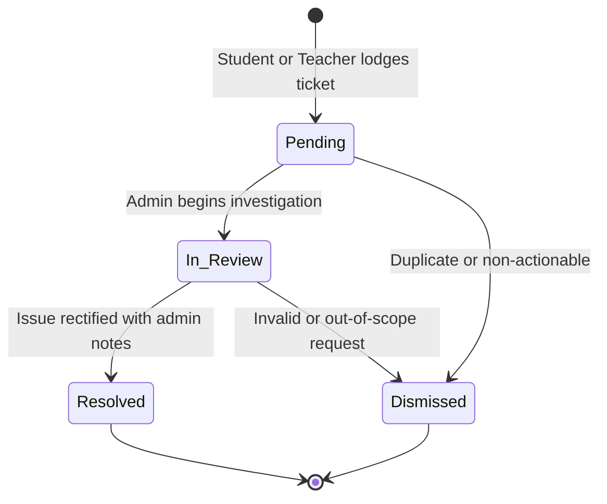

# PUCIT Grievance & Complaint Redressal Platform

[](https://www.php.net/)
[](https://www.mysql.com/)
[](https://httpd.apache.org/)
[](#license)

A modern, secure, and role-aware grievance management platform developed for the **Punjab University College of Information Technology (PUCIT / FCIT), University of the Punjab**. The application enables students and faculty members to lodge facility, computer lab, academic, and administrative concerns while guaranteeing identity protection. College administrators can review, triage, update, and resolve tickets with real-time email notifications and an unalterable audit trail.

---

## 📌 Key Highlights

- **Role-Based Access Control (RBAC)**: Distinct workflows and specialized dashboards for **Students**, **Teachers / Faculty**, and **Administrators**.
- **Whitelisted University Authentication**: Account registration is locked strictly to official domains (`@pucit.edu.pk` and `@pu.edu.pk`).
- **Two-Factor Faculty Verification**: Teacher registrations automatically require a 6-digit email OTP to verify institutional affiliation.
- **Strict Identity Protection & Anonymity**: Public grievance feeds protect complainant identities, revealing personal identifiers exclusively inside the password-protected Administrative Portal.
- **Live Gmail SMTP Notifications**: Instant email dispatch to complainants upon ticket submission, status modifications, and administrative password resets.
- **Interactive Resolution Timeline**: Expandable ticket journey (`<details>` timeline) tracking status changes, remarks, handler names, and timestamps.
- **Immutable Audit Logging**: Every administrative action is permanently recorded in `admin_actions` and local email audit logs.
- **Zero-Dependency Architecture**: Built using pure vanilla PHP 8, modern CSS3 (Flexbox/Grid), and standard MySQLi — zero external bloated dependencies.

---

## 🏛️ System Roles & Capabilities

| Feature / Permission | Student | Teacher / Faculty | Administrator |
| :--- | :---: | :---: | :---: |
| File Grievance with optional Photo Attachment | ✅ | ✅ | ✅ |
| Track Status & History of Own Tickets | ✅ | ✅ | ✅ |
| View Public Campus Grievances & Resolutions | ✅ | ✅ | ✅ |
| Complainant Identity Protected in Public View | ✅ | ✅ | N/A |
| Access Administrative Portal & Analytics | ❌ | ❌ | ✅ |
| Decrypt / Inspect Complainant Identity | ❌ | ❌ | ✅ |
| Update Ticket Status & Attach Resolution Notes | ❌ | ❌ | ✅ |
| Dynamic Category Management (CRUD) | ❌ | ❌ | ✅ |
| User Role Modification & Account Suspension | ❌ | ❌ | ✅ |
| Direct Password Reset with Temp Email Credentials | ❌ | ❌ | ✅ |
| Inspect Permanent Audit Trails (`admin_actions`) | ❌ | ❌ | ✅ |

---

## 🛡️ Security Architecture

1. **Defense-in-Depth Session Hardening**:
   - Centralized in `includes/session.php`.
   - `HttpOnly` cookie flags prevent JavaScript-based XSS session theft.
   - `SameSite=Lax` cookies provide cross-site request forgery resistance.
   - Configurable server-side lifetime with 30-day "Remember Me" persistent token support.
   - Cryptographic session regeneration (`session_regenerate_id(true)`) upon authentication.

2. **CSRF & Rate Limiting Defense**:
   - Cryptographically random CSRF tokens (`bin2hex(random_bytes(32))`) validated on every state-changing POST request.
   - IP-based rate limiting on login attempts (5 per 5 min), user registrations (5 per hour), password reset requests, and OTP verifications with automatic table pruning.

3. **Secure File Upload Pipeline**:
   - Server-side MIME-type verification via PHP `mime_content_type()`.
   - File extension whitelisting (`jpg`, `jpeg`, `png`, `webp`) capped at 5 MB.
   - Randomized filenames (`bin2hex(random_bytes(16))`) prevent directory traversal and name spoofing.
   - Dedicated `uploads/.htaccess` and root `.htaccess` preventing direct PHP script execution inside the upload folder.

4. **Audit Log Privacy**:
   - Dedicated `logs/.htaccess` with `Require all denied` and Apache rewrite rules prevent direct browser HTTP access to system audit logs.

5. **Post/Redirect/Get (PRG) Pattern**:
   - Universal implementation across all form submissions (`home.php`, `profile.php`, `admin/index.php`, `admin/categories.php`, `admin/users.php`) eliminating duplicate submissions on browser refreshes.

---

## 🔄 Complaint Lifecycle & Workflow



1. **Pending**: Initial state upon submission. Automated confirmation dispatched to the complainant's university email, and alert sent to IT Support.
2. **In Review**: Administrator accepts ticket and initiates resolution. Complainant is notified via email.
3. **Resolved**: Issue addressed. Administrator attaches resolution notes; email dispatched with remarks and resolved timestamp.
4. **Dismissed**: Ticket dismissed with explanatory administrative remarks logged to audit trail.

---

## 📂 Project Directory Structure

```text
Pucit-complaint-platform/
│
├── admin/
│   ├── index.php          # Main Admin Dashboard, stats, ticket triage & modal updater
│   ├── categories.php     # Dynamic category management (CRUD & ordering)
│   ├── users.php          # User administration, role switcher & password reset
│   ├── logs.php           # Immutable system audit trail browser
│   └── setup.php          # Initial one-time administrator bootstrap (auto-locks)
│
├── includes/
│   ├── auth.php           # CSRF verification & rate limiting helpers
│   ├── mailer.php         # Raw socket SMTP mailer (Gmail TLS port 587) & local logger
│   └── session.php        # Centralized hardened session configuration
│
├── logs/
│   ├── .htaccess          # Direct HTTP access forbidden (Require all denied)
│   ├── .gitkeep           # Preserves log directory structure
│   └── emails.log         # Local email dispatch audit records
│
├── uploads/
│   ├── .htaccess          # Blocks execution of uploaded scripts
│   └── .gitkeep           # Preserves upload directory structure
│
├── .env                   # Environment credentials (SMTP, DB config - git ignored)
├── .env.example           # Template for environment configuration
├── .gitignore             # Git ignore rules for logs, environment files & uploads
├── .htaccess              # Apache security headers, rewrite rules & directory locks
├── config.php             # Core platform constants, paths & email domain rules
├── db.php                 # Database connection & schema migrations
├── home.php               # Student & Teacher portal (tickets list, stats, submission form)
├── index.php              # Landing page & new user registration
├── login.php              # Secure login & password recovery request handler
├── logout.php             # Session destruction & cookie purging
├── profile.php            # User profile & permanent password updater
├── signup.php             # Route alias to registration portal
├── style.css              # Unified university design system (responsive CSS3)
├── verify.php             # Faculty 6-digit OTP verification interface
└── README.md              # Technical documentation
```

---

## ⚙️ Installation & Local Setup

### 1. Prerequisites
- **Web Server**: Apache 2.4+ with `mod_rewrite` and `mod_headers` enabled.
- **PHP**: PHP 8.1 or newer (extensions required: `mysqli`, `openssl`, `fileinfo`, `session`).
- **Database**: MySQL 8.0+ or MariaDB 10.4+.

### 2. Clone the Repository
```bash
git clone https://github.com/Ali-Hamza-jhujh/Pucit-complaint-platform.git
cd Pucit-complaint-platform
```

### 3. Configure Database
Log into MySQL and initialize the database:
```sql
CREATE DATABASE devdb CHARACTER SET utf8mb4 COLLATE utf8mb4_unicode_ci;
CREATE USER 'devuser'@'localhost' IDENTIFIED BY '2026';
GRANT ALL PRIVILEGES ON devdb.* TO 'devuser'@'localhost';
FLUSH PRIVILEGES;
```
*(The platform runs automated schema migrations via `db.php` upon initial page load, creating all required tables and default categories automatically).*

### 4. Configure Environment Variables
Copy the sample configuration file:
```bash
cp .env.example .env
```
Edit `.env` with your preferred credentials:
```ini
APP_NAME="PUCIT Complaint Portal"
APP_ENV=development
APP_DEBUG=true

# Database Configuration
DB_HOST=localhost
DB_NAME=devdb
DB_USER=devuser
DB_PASS=2026
DB_PORT=3306

# Administrative Support Recipient
SUPPORT_EMAIL=oalihamza8@gmail.com

# Gmail SMTP Configuration
SMTP_ENABLED=true
SMTP_HOST=smtp.gmail.com
SMTP_PORT=587
SMTP_USER=your_email@gmail.com
SMTP_PASS=your_gmail_16_digit_app_password
SMTP_FROM_NAME="PUCIT Complaint Platform"
```

### 5. Set Filesystem Permissions
Ensure the web server daemon (`www-data`) has read/write permissions for file uploads and audit logs:
```bash
sudo chown -R www-data:www-data uploads/ logs/
sudo chmod -R 775 uploads/ logs/
```

### 6. Apache VirtualHost (Optional)
If configuring with a local domain like `http://dev.local/`:
```apache
<VirtualHost *:80>
    ServerName dev.local
    DocumentRoot /var/www/html/dev/public/Pucit-complaint-platform
    
    <Directory /var/www/html/dev/public/Pucit-complaint-platform>
        AllowOverride All
        Require all granted
    </Directory>
    
    ErrorLog ${APACHE_LOG_DIR}/pucit_error.log
    CustomLog ${APACHE_LOG_DIR}/pucit_access.log combined
</VirtualHost>
```

---

## 🧪 Testing Email Dispatch & Dev Mode

When `SMTP_ENABLED=true` is set with a valid Gmail App Password:
- Status update notifications are dispatched live to the complainant's email via Gmail SMTP TLS port 587.
- Outgoing emails are mirrored into `logs/emails.log` for debugging and administrative auditing.
- If SMTP credentials are not configured, the system gracefully falls back to logging emails locally without halting user operations.

---

## 👥 Default Roles & Test Credentials

| Role | Email Domain Rule | Capabilities |
| :--- | :--- | :--- |
| **Student** | Contains program prefix/roll numbers (e.g. `bcsf24m...`) | Submit complaints, view personal tickets, monitor public board |
| **Teacher** | Official academic naming format | Faculty portal access, submit complaints, receive status alerts |
| **Admin** | Role assigned in `USERS` table | Triage tickets, update statuses, manage categories, audit logs |

---

## 📄 License & Academic Attribution
Developed as an official semester capstone project for the **Punjab University College of Information Technology (PUCIT)**, University of the Punjab, Lahore, Pakistan. All rights reserved.
